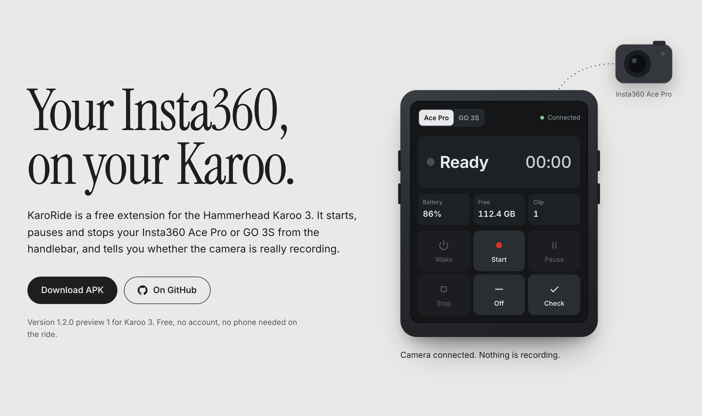

# KaroRide

KaroRide is a free extension for the Hammerhead Karoo 3 that controls your Insta360 Ace Pro or GO 3S from the handlebar.

[Website](https://hellmold.de/karoride/?lang=en) · [Download 1.2.0-preview.1](https://github.com/242Xtro/KaroRide/releases/tag/v1.2.0-preview.1) · [Deutsch](README.de.md) · [Ko-fi](https://ko-fi.com/karoride)

The title image is an illustration rendered from the website, not a device screenshot. Real ride photos and screenshots will follow.

## What it does

Add KaroRide as a full data page and you get big buttons for wake, start, pause, stop and power off, plus battery, free storage and clip length at a glance.

Prefer your usual page? Drop the start/stop field between speed and power, and control the camera without switching pages.

A recording only shows as running once the camera confirms it. If Bluetooth drops, KaroRide says **Unknown** and keeps the last confirmed state, instead of making one up.

## Cameras

| Feature | Insta360 Ace Pro, 1st generation | Insta360 GO 3S, tested in the Action Pod |
|---|---|---|
| Start and stop recording | Yes | Yes |
| Pause and resume3 | Yes | Yes |
| Battery, free storage, clip length | Yes | Yes |
| Wake the camera from the Karoo | Yes1 | In testing |
| Switch the camera off from the Karoo | Yes | No2 |

1. Ace Pro: turn on **Bluetooth Wakeup** in the camera settings. KaroRide only reports the camera as awake once it has connected and answered.
2. GO 3S: the Insta360 SDK has no power-off command for it. Disconnect in KaroRide, then switch off on the camera. Use outside the Action Pod hasn't been tested yet.
3. Pause ends the current clip, resume starts a new one. Both cameras work the same way here.

Next up is the **X3**. The **X5** and the **Ace Pro 2** are planned. They are not supported by this preview. If you own one and want to help test, [open an issue](https://github.com/242Xtro/KaroRide/issues).

## Install

1. **Get the APK onto your Karoo.** Open the [website](https://hellmold.de/karoride/?lang=en) on your phone and download the APK. Tap Share and pick the Hammerhead Companion app. Or share the [APK download link from the GitHub release](https://github.com/242Xtro/KaroRide/releases/download/v1.2.0-preview.1/KaroRide-1.2.0-preview.1.apk) with the Companion app. Confirm Install on your paired Karoo. [Hammerhead's sideloading guide](https://support.hammerhead.io/hc/en-us/articles/31576497036827-Companion-App-Sideloading).
2. **Pair your camera.** On the Karoo open Extensions, KaroRide, Open. Accept the SDK notice and allow Bluetooth. Switch the camera on, pick it from the list and confirm on the camera if it asks.
3. **Put it in your ride profile.** Add a data page with **CAMERA CONTROL** as its only field. Or place **CAMERA START / STOP** next to your usual data. In German, the fields are **KAMERA STEUERUNG** and **KAMERA START / STOPP**.

Updating later: install the new APK over the old one. Don't uninstall first, and your settings stay. Keep using the project-signed APK; community builds with another key cannot update it. [Checksum and update details](docs/RELEASE.md).

## Questions

Do I need my phone on the ride?

No. The Karoo talks to the camera directly over Bluetooth. Your phone is only needed once, to get the APK onto the Karoo.

What happens if the connection drops?

The camera may keep recording. KaroRide shows the state as Unknown and marks the last confirmed status. Once it reconnects, it reads the real state from the camera.

Does a pause stay in the same video file?

No. Pause ends the clip, resume starts a new video file. KaroRide remembers per camera that you paused.

Can I control two cameras at the same time?

KaroRide controls one selected camera at a time. Stop or pause a running recording before you switch. That's a rule of the app, not a limit of the cameras.

Why can't I switch off the GO 3S?

The SDK KaroRide uses has no power-off command for it. Disconnect in KaroRide first, then switch the camera off on the device. A dark Pod display doesn't automatically mean the camera is off.

Will it change my video settings?

No. Resolution, frame rate and stabilisation stay as they are. Set a suitable video mode on the camera; KaroRide never switches it silently.

Is the app in English or German?

Both. KaroRide starts in English. In the three-dot menu under Language / Sprache you can switch to German, and the ride fields switch along with it.

Is this an official app?

No. KaroRide is an independent project. It uses the Insta360 Camera SDK and Hammerhead's karoo-ext, without any partnership with either company.

## Build

[Build guide](docs/BUILD.md) · [Sources and versions](docs/SOURCES.md) · [Validation](docs/VALIDATION.json)

Tool and dependency versions are pinned. Developers need their own authorised Insta360 SDK access and their own private signing key. SDK packages, credentials and the project's release key are not included in this repository. No cloud build is configured.

For this unchanged APK, 122 JVM simulations, the Android release build and a byte-identical offline rebuild passed. Lint reported 0 errors and 18 warnings. Previous basic Ace Pro and GO 3S Action Pod controls were reported working by the user. The new 1.2.0 language picker and the complete hardware test matrix still need device checks. A build or simulation is not a Bluetooth compatibility test.

## Privacy

Camera profiles, pause intention and language choice stay in private app preferences. Videos stay on the camera. The app uses Bluetooth and a connected-device foreground service, with no internet, location, media, storage or notification-access permission. [App privacy](docs/PRIVACY.md) · [Website privacy](https://hellmold.de/karoride/datenschutz.html?lang=en).

Support through [Ko-fi](https://ko-fi.com/karoride) is voluntary. KaroRide remains free. The payment provider opens only when you follow the link.

## License

Own code and the retained Hammerhead runtime use Apache-2.0. See [LICENSE](LICENSE), [NOTICE](NOTICE) and [source credits](docs/SOURCES.md). The proprietary Insta360 SDK remains subject to its [SDK terms](https://www.insta360.com/support/supportcourse?post_id=20734). The Apache license does not grant rights to those binaries.

KaroRide is an independent project by Markus Hellmold, without any partnership with Hammerhead or Insta360. Product names identify compatible equipment. No third-party app signing key is used. The software is provided without warranty.
