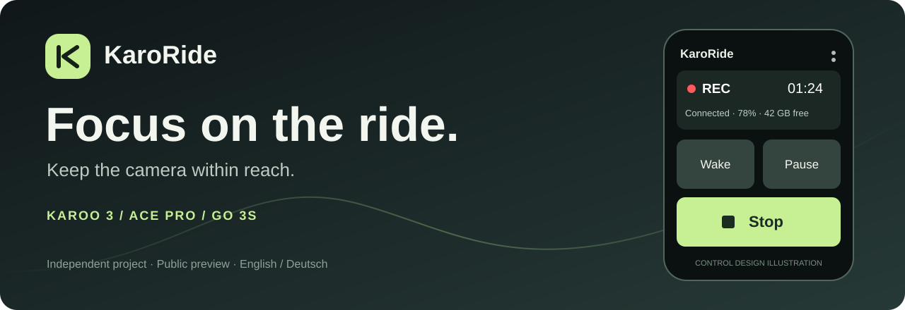

# KaroRide

**Control your Insta360 Ace Pro or GO 3S from Hammerhead Karoo 3.**

**Public preview `1.2.0-preview.1`** · [Download & release notes](https://github.com/242Xtro/KaroRide/releases/tag/v1.2.0-preview.1) · [Deutsch](README.de.md) · [Buy me a coffee](https://ko-fi.com/karoride)

Big ride controls, a start/stop data field, camera switching and clear camera status.
One selected camera is controlled at a time. Pause ends a clip; resume starts a new
file. Starting a ride, reconnecting or restarting Karoo never starts recording automatically.

| On your ride page | At a glance | Set up once |
|---|---|---|
| Large start, stop, pause and resume controls | Recording, connection, battery, free storage and clip duration | Save camera profiles and switch after stopping |
| Full-page camera control or compact start/stop field | Confirmed camera feedback; unknown states shown clearly | English by default, German selectable; works offline after setup |

The illustration above is a design illustration. Real device screenshots will be
added later. The separate project website is being prepared for hellmold.de.

## What works and what is still being tested

| Model | Preview scope | Limits |
|---|---|---|
| Original Ace Pro, first generation | Manual controls, camera battery/free storage/clip duration, wake and shutdown adapter | Bluetooth Wakeup must be enabled. A wake signal is only successful after connection and status confirmation. Longer off periods still need testing. |
| GO 3S | Manual controls and camera selection; basic use in the Action Pod reported working | No SDK power-off command. Disconnect first, then power off on the camera. Outside-Pod and longer wake-up testing remain open. |

The user has confirmed everyday controls, switching after stop, data-field setup and
the dedicated ride page. This is not a completed per-case hardware test matrix.
The new 1.2.0 language picker and its persistence still need a device update check.
The app defaults to English. Choose English/Deutsch in the three-dot menu → Language / Sprache. The choice is stored locally and updates live ride-field controls too. The website and documentation support DE/EN.

X3 is the next planned addition. X5 and Ace Pro 2 are planned and require device
testers. They are **not supported by this preview**. No delivery date is promised.

## Install

1. Download **KaroRide-1.2.0-preview.1.apk** and its `.sha256` file from the
   [preview release](https://github.com/242Xtro/KaroRide/releases/tag/v1.2.0-preview.1).
2. Transfer the APK to your phone and share it with the Hammerhead Companion app.
   Confirm installation on Karoo. [Official sideloading instructions](https://support.hammerhead.io/hc/en-us/articles/31576497036827-Companion-App-Sideloading).
3. Open Extensions → KaroRide → Open. Accept the SDK notice, allow required Bluetooth
   permissions and select your powered-on camera. Confirm authorisation on the camera if prompted.
4. Add a full-size **CAMERA CONTROL** / **KAMERA STEUERUNG** field as the only
   field on a new data page, or add **CAMERA START / STOP** / **KAMERA START / STOPP**
   alongside your usual ride data. Karoo-owned pickers can follow the system language.

Before riding, open KaroRide and connect the camera. The connection is maintained
when you leave the setup screen. Recording status is based on camera feedback.
After a drop, the camera may still record; the app shows Unknown and the last
confirmed status. Reconnect deliberately and reconcile the actual state first.

## Updating from AceRide

KaroRide is the new display name. Package `de.markus.aceride`, extension ID `aceride`
and field IDs are intentionally retained, as is the project's release signing key.
Install the release APK as an update without uninstalling first. The versionCode
is now 9. Camera settings normally remain. The first-use SDK notice needs acceptance once.

Camera resolution, frame rate and stabilisation are preserved. Select a suitable
video mode on the camera. Uninstalling deletes app data, not camera videos.

## Build and verification

[Build guide](docs/BUILD.md) · [Privacy](docs/PRIVACY.md) · [Release checksums & updates](docs/RELEASE.md) · [Validation summary](docs/VALIDATION.json)

122/122 JVM simulations passed. Android release build and byte-identical full
offline rebuild passed. Lint: 0 errors, 18 documented warnings. Simulations and a
successful build do not establish Bluetooth compatibility or every hardware case.

The app requests BLE scan/connect and optional advertising for Ace Pro wake-up,
plus a connected-device foreground service. No internet/location/media/storage/
notification-access permission is requested. Manufacturer SDK binaries and native
libraries are not distributed separately in this source repository. Developers
need their own authorised SDK access and private local credentials.

## Feedback and support

Open a bug report or feature request. Describe the model, preview version and exact
steps. Do not post passwords, tokens, full serial numbers, Bluetooth addresses,
private logs or videos. Remove identifiers from screenshots before sharing them.

The app is free. If it makes your ride easier, [buy me a coffee on Ko-fi](https://ko-fi.com/karoride).
Sometimes the next small improvement starts with a coffee — or a new inner tube.
Support is voluntary and does not buy a support contract or feature deadline.

## License and independence

Own code and the retained Hammerhead runtime: Apache-2.0; see [LICENSE](LICENSE)
and [NOTICE](NOTICE). Insta360 SDK binaries are proprietary and remain subject to
the [SDK terms](https://www.insta360.com/support/supportcourse?post_id=20734).
The Apache license does not grant rights to those binaries. Notices and source
copyrights are retained. No third-party application signing key is used.

KaroRide is an independent project by Markus Hellmold, not an official manufacturer
app. Hammerhead/Karoo and Insta360 product names identify compatible equipment.

The website screenshots are intentionally marked placeholders until real approved
screenshots replace them. It loads no remote fonts, analytics or payment widgets.
